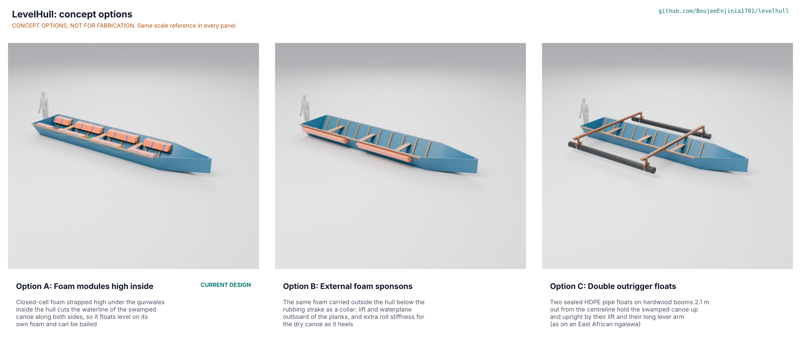

# LevelHull concept options

Option A, the existing design (foam modules high inside the hull), scores 172 of 215; option B (external foam sponsons) scores 163, only 5.2 % behind, so **both go to Amish without a pick** (STANDARDS section 21). Option C (double outrigger floats) scores 148 and is not put forward. The repo stays on option A, its current design, until Amish decides: this is **Proposed, awaiting Amish** (LVH-DEC-001 D-O1, LVH-DDR-004). Method: STANDARDS section 21. Numbers: `docs/04-calcs/stem_check.py` (`options_results.csv`), LVH-CAL-001 and `cad/fidelity.json`.

*Figure 1. The three options, each modelled at detail level D3 in `cad/src/model.py`, drawn at one scale with a 1.75 m person (rendered with `python .kit/options.py` in Blender Cycles).*

> **Safety:** Every option is flotation for a boat, not for people, and none is a substitute for life jackets. Each would be swamp-tested in sheltered, shallow water with a safety boat and everyone in a life jacket before use.

## The options

### Option A: foam modules high inside (the design)

Closed-cell foam strapped high under the gunwales inside the hull cuts the waterline of the swamped canoe along both sides, so it floats level on its own foam and can be bailed. Eight modules of four 50 mm polyethylene foam strips in sewn tarpaulin covers, 220 x 200 mm, 4.78 m a side, sit on hardwood shelf battens coach-screwed to the frames and are held down by webbing straps with D-ring buckles; grab lines run along both sides through eye bolts in the top plank. This is the constructable design of LVH-DDR-002 and LVH-DDR-003, unchanged except for the chock screw fix of LVH-DEC-001 D-S1. Swamped at the design load: 92 mm lowest freeboard, 761 kg m per radian, 2.45 times the design load in reserve, still afloat with the largest module lost. It takes 8.4 % of the inside volume, high along the sides. Key risks: cover and strap life in the sun (S10), owners accepting the lost space. Needs from a partner: hull and load surveys, a swamp test.

### Option B: external foam sponsons

The same foam carried outside the hull below the rubbing strake as a collar: lift and waterplane outboard of the planks, and extra roll stiffness for the dry canoe as it heels. Two sponsons a side, each 2.39 m long, of the same 220 x 200 mm foam stack in a tarpaulin sleeve whose doubled flanges are clamped to the planking by an outside hardwood shelf batten (below) and a hardwood clamp strip (above, up to the rubbing strake), both through-bolted with M8 bolts through the planks into every frame. Swamped: 158 mm lowest freeboard, 1,546 kg m per radian, 1.9 deg with all four crew on one side; nothing inside the hull. Against it: 32 new bolt holes through the planks (150 mm above the loaded waterline), a beam of 1.93 m over the sponsons, covers exposed to the beach, to rafting alongside and to nets hauled over the side (S27), and, as drawn, losing one sponson (half a side) puts the gunwale 32 mm under. Needs from a partner: a trial of abrasion on the landing beach and of net handling over the sponsons.

### Option C: double outrigger floats

Two sealed HDPE pipe floats on hardwood booms 2.1 m out from the centreline hold the swamped canoe up and upright by their lift and their long lever arm, as on an East African ngalawa. Two 120 x 90 mm hardwood booms cross the gunwales over the aft and forward thwarts on saddle blocks, bolted down through the rubbing strakes; a strut with a saddle foot at each boom end carries a 4.46 m float of 250 mm PE100 SDR 26 pipe with butt-fused end caps, held by stainless U-bolts. Swamped: 160 mm lowest freeboard and very high roll stiffness (6,300 kg m per radian); the dry canoe also resists capsize, which A and B do not. Against it: a 4.45 m beam at crowded landing sites, booms and floats in the way of nets hauled over the side, 129 kg of kit, butt fusion of the caps needs a fusion machine, and with one float lost the canoe capsizes. Needs from a partner: a fishery that already sails outrigger canoes (coastal, not the planked lake canoes of the reference).

## First-order numbers

Table 1. Options compared (reference canoe, fresh water, design net load 118 kg; option A from LVH-CAL-001, B and C from `stem_check.py` with the same method; part counts and model masses from `cad/fidelity.json`).

| Quantity | Option A | Option B | Option C |
| --- | --- | --- | --- |
| Estimated parts cost per canoe (USD) | 694 (priced BOM, four bailers) | about 620 (estimate from the BOM's own unit prices; bolts priced as BOM line 3) | about 220 known (timber, bolts, bailers) plus 8.9 m of 250 mm HDPE pipe, price to assess |
| Kit mass (kg) | 68.9 (CAL); 98.8 in the model | about 70 (estimate); 98.7 in the model | 128.8 (estimate); 159.9 in the model |
| Buoyancy volume (m3) | 0.42 | 0.42 | 0.44 |
| Swamped lowest freeboard (mm) | 92 | 158 | 160 |
| Swamped roll stiffness (kg m per radian) | 761 | 1,546 | 6,313 |
| Four crew on one side: heel, low-side freeboard | 3.9 deg, 44 mm | 1.9 deg, 123 mm | 0.5 deg, 132 mm |
| Largest buoyancy unit lost | Floats, 25 mm | Gunwale 32 mm under | Capsizes |
| Inside volume taken | 8.4 % | None | None (booms cross above the gunwale) |
| Overall beam | 1.68 m (unchanged) | 1.93 m | 4.45 m |
| New holes in the hull | 8, in the top plank | 32 through the planks, 150 mm above the loaded waterline | 16, through the rubbing strakes |
| Parts in the model (D3) | 209 | 124 | 124 |
| STEM check | Within known science; 4 field items open; brim-full freeboard and bailing (S32, S34) closed by Amish's decisions D-O2 and D-O3 of 2026-10-25 | Within; abrasion open; holes below the swamped waterline | Within |

All three options are sealed hulls, so the brim-full condition just after swamping (LVH-STM-001 S2, S32 to S34) applies to each of them alike and does not change the ranking. The model masses are higher than the calculated kit masses because the kit has no closed-cell foam material, so the foam is modelled at 120 kg/m3 (four times the real 30 kg/m3), and hardwood at 800 kg/m3. The cost of option B is an estimate built from the unit prices already in `bom/bom.csv`; option C's pipe price is not known and is left to assess, as no price is invented.

## Scoring

Table 2. Weighted scoring (weights: High UR 3, Medium 2, Low 1; scores 1 to 5). UR-010 (cost) is scored in the cost row. UR-015 (life jacket message) and UR-016 (sizing method) score the same for every option and are left out.

| Criterion | Source | Weight | A | B | C | Reason |
| --- | --- | --- | --- | --- | --- | --- |
| Stays afloat with crew, motor, gear and catch | UR-001 | 3 | 4 | 5 | 5 | Reserve 2.45 for A; B and C carry more at 50 mm |
| Gunwale clear of the water when swamped | UR-002 | 3 | 4 | 5 | 5 | 92, 158 and 160 mm |
| Floats upright and level | UR-003 | 3 | 4 | 5 | 5 | Roll stiffness 761, 1,546 and 6,313 kg m per radian |
| Two crew can bail it out | UR-004 | 3 | 4 | 4 | 4 | Same water to bail in each |
| Room to work, stow catch and handle nets | UR-005 | 3 | 3 | 5 | 2 | A takes 8.4 % high on the sides; B nothing inside; C's booms cross the canoe and its floats sit where nets come in |
| Keeps its lift in water, sun and fuel | UR-006 | 3 | 4 | 3 | 4 | A's covers are inside; B's are outside on the beach; C's PE100 pipe is tough |
| Stays fixed when full of water or rolled | UR-007 | 3 | 4 | 3 | 3 | A's fixings at 5 times their share; B hangs on tarpaulin flanges; C's booms take wave loads (8.5 MPa against 16) |
| Fitted in a day with hand tools, no holes below the waterline | UR-008 | 3 | 5 | 3 | 2 | A: 8 holes in the top plank; B: 32 holes in the planks; C: butt fusion needs a machine |
| Lasts a year of normal use | UR-009 | 2 | 3 | 2 | 4 | Tarpaulin life decides A and B |
| Reserve for an extra person or a wet net | UR-011 | 2 | 4 | 5 | 5 | B and C have more freeboard |
| Still floats with one unit damaged | UR-012 | 2 | 4 | 1 | 1 | A: 25 mm; B: gunwale under; C: capsizes |
| Level with all crew on one side | UR-013 | 3 | 4 | 5 | 5 | 3.9, 1.9 and 0.5 deg |
| Out of the way when beaching, landing and fishing | UR-014 | 2 | 5 | 2 | 1 | A inside the hull lines; B 1.93 m beam; C 4.45 m |
| Cost against the value-engineering target | UR-010 | 2 | 3 | 3 | 2 | A USD 694, B about USD 620, C pipe unpriced and the most material |
| Buildable with local skills and tools | | 2 | 5 | 4 | 2 | A and B: carpentry and sewing; C needs HDPE fusion |
| Safety | | 3 | 4 | 4 | 3 | C also stops the dry canoe capsizing, but one lost float capsizes it and the booms are a hazard alongside |
| Maintenance | | 1 | 4 | 3 | 4 | B's external covers wear first |
| **Weighted total (of 215)** | | | **172** | **163** | **148** | A 80 %, B 76 %, C 69 % |

## Recommendation

A and B are within 10 % of each other (163 against 172, 5.2 %), so both go to Amish without a pick, as the standard asks. The case for each:

- **Keep option A (the design).** It is already constructable, priced and planned; it keeps everything inside the hull lines, needs only eight holes in the top plank and survives the loss of its largest module. Its weakness is the space it takes and the lowest freeboard of the three (92 mm, still above the 50 mm target).
- **Change to option B.** The same foam outside the planks gives two-thirds more freeboard and twice the roll stiffness and takes no space inside. It needs 32 bolt holes through the planks, widens the canoe to 1.93 m, exposes the covers to beach and nets, and as drawn fails R12 if one sponson is lost (shorter sponsons, three or four a side, would cure that at more cost).

**Best idea to graft from the runner-up.** B's numbers show that the same foam gives more freeboard when it sits lower, as long as it still cuts the waterline: in B the foam starts 360 mm up, in A 420 mm. Lowering A's modules and battens by about 40 mm would raise its swamped freeboard and keep everything inside, at some cost in clear width and roll stiffness. That is a change to a design dimension and goes to Amish with D-O1; it is not made here. From C, nothing is grafted: its intact stability needs the outriggers themselves.

The choice is recorded as "Proposed, awaiting Amish" in LVH-DEC-001 (D-O1) and argued in LVH-DDR-004. Until he decides, the drawing, priced BOM and build plan describe option A.
